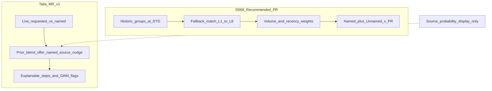

# D006 Group & Allotment PR% vs Talia MR

**Document ID:** **D006-1** (response to **D006** *MR Business Requirement*)  
**Audience:** Management and commercial / inventory stakeholders  
**Status:** Comparison and recommended action plan  
**Date:** 3 November 2026  
**Sources:** Project document **D006** (*MR Business Requirement*), Talia Groups Explorer / Talia MR Method (platform **0.4.0**), functionality matrix items **R019–R023**

---

## 1. Executive summary

D006 and Talia MR both answer *how much of a group will materialise*, but they are **not the same control**.

| | **D006 — Recommended PR%** | **Talia MR v1** |
|--|----------------------------|-----------------|
| **Job** | Recommend a **Seaware-style unnamed-cabin probability** for a new or open Group/Allotment | Estimate **live guest materialisation** for GRM (Groups Explorer) |
| **Method** | Historic peers at comparable **DTD**, fallback matching, volume + recency weights | Named progress vs requested size, with a **mild** nudge from source probability |
| **Shipped today?** | **Requirement only** (documented; not an engine) | **Yes** — explainable formula, panels, and historic review tooling |

**Recommendation:** Keep **Talia MR** as the operational GRM expectation and transparency layer. Treat D006 as a separate **Recommended Seaware PR%** workstream that should **reuse** Talia’s historic extract and path tooling, surface a recommendation beside Source/Talia rates, and **never** silently overwrite Seaware. Build the PR% engine only after a short data-feasibility pass (Phase 1), then back-test before controller workflow.

---

## 2. Glossary (terms change — read this first)

Commercial language mixes **PR%**, **probability**, **MR**, and **materialisation**. In Talia and in D006 they mean different things.

| Term | Meaning here |
|------|----------------|
| **Source MR / source probability** | Rate from Seaware / warehouse (`group_probability` → reservation probability → …). In Talia GRM it is **display-only**. Talia MR is **never copied** from it. |
| **PR% (D006)** | Probability applied to **unnamed allocated cabins** in Seaware. Named cabins are treated as 100%. D006 defines how to *recommend* that PR% from history. |
| **Talia MR** | Talia’s own **guest** materialisation rate (0–1): prior → named blend → offer/named adjustments → soft source nudge. Published in Groups Explorer and explained in Talia MR Method. |
| **Revised MR** | Product name for a **future** history-backed rate (agency / peerset). Not shipped as a separate field today. |
| **Realised rate** | After the fact: named (or final materialised) ÷ requested — used in historic review, not as the live PR% engine. |
| **DTD** | Days to departure — central to D006 matching; not an input to Talia MR v1 arithmetic. |

**One-line rule for stakeholders:** *Source shows what Seaware says; Talia MR shows what Talia believes from naming progress; D006 PR% is what we would recommend Seaware use for unnamed cabins.*

---

## 3. Side-by-side comparison

| Dimension | D006 (Recommended PR%) | Talia MR v1 (shipped) |
|-----------|------------------------|------------------------|
| **Objective** | Recommend PR% for each Group/Allotment ID from comparable historic materialisation | Estimate how many **requested guests** will be named |
| **Grain** | **Cabins** (blocked @ DTD vs final materialised; unnamed PR%) | **Guests** (requested × rate → expected guests) |
| **Timing** | Point-in-time at selected **DTD** bands; 36-month historic window | **Live** book (and frozen extract for review/examples) |
| **Primary evidence** | Peer groups matching account/market/type/product/size/status/DTD | **This** group’s naming progress vs request |
| **Matching / fallback** | Explicit ladder Levels **1–8** (broaden month → size → market → product → …) | No peer ladder; single rule path per group |
| **Weighting** | Cabin-volume weights + recency bands (20/30/50 illustrative) | Fixed blend weights (e.g. 35% prior / 65% named ratio) |
| **Source probability** | Historic Seaware PR% is an **observation** to learn from; output is a **new** recommendation | Source may **nudge** (15% of gap if ≥5 pts); never becomes the answer |
| **Seaware conversion** | `Expected = Named + (Unnamed × PR%)` with explicit new vs partial-named cases | Not modelled; Talia does not write Seaware PR% |
| **Explainability** | Match level + calculation steps (designed) | Step sentences + Groups Explorer flags + Method panel (**live**) |
| **Shipping status** | Document D006 + matrix R019–R023 | Groups Explorer, Talia MR Method, Source MR Review, Historic MR Path |

### Talia MR v1 in one paragraph

Start at a **50% prior**. If there is a requested size, blend with named/requested (**35% / 65%**). Cut **15%** for empty offers with nobody named; add **8 pp** when named booked exists. If source differs by ≥5 points, move **15% of the gap** toward source. Large groups on a distressed sailing can be cut **10%** (distress wiring from remaining capacity is still incomplete in live GRM). Clamp 0–100%. Expected guests = request × rate.

### D006 PR% in one paragraph

Find historic groups comparable at the same **DTD band**, requiring a minimum unique-ID sample (provisionally **4**, to validate). Broaden match criteria through a fixed fallback sequence. Compute a volume- and recency-weighted historic materialisation rate, temper with historic **actual production** vs allocation size, then convert into Seaware’s **unnamed** PR% given current named/unnamed split. Back-test against history before trusting the ladder.

---

## 4. Where Talia is already more complete

These capabilities exist in the product today and go **beyond** what D006 alone specifies:

1. **Live, explainable GRM rate** — Groups Explorer shows Source MR and Talia MR side by side, with reasons and impact flags (weak MR, below source, value at risk, cabins/guests at risk). Controllers can act without waiting for a historic peer engine.
2. **Stakeholder walkthrough** — Talia MR Method documents sources, known issues (e.g. blank live probability treated as 100% source before nudge), and worked examples.
3. **Historic source effectiveness** — Source MR Review calibrates how source rates behaved vs realised naming on sailed extract data.
4. **Pre-departure path** — Historic MR Path shows how hold/quote expectations evolved toward departure and highlights overstated quotes — useful governance even before a PR% recommender ships.
5. **Product discipline** — Source probability is not overwritten; Talia MR stays independent. That protects auditability and matches the intent that a recommendation (D006) should be **chosen**, not silently applied.
6. **Operational panels in one workspace** — Same sail selection bus, report shell, and export path as the rest of Talia.

D006 is stronger as a **specification for inventory PR% recommendation**. Talia is stronger today as a **working GRM and review system**.

---

## 5. Development requirements (D006 → backlog)

Map of D006 content to what must be built (aligned with matrix **R019–R023**).

| D006 theme | Requirement | Matrix | Status |
|------------|-------------|--------|--------|
| Historic period / DTD snapshots | Point-in-time cabins blocked vs final materialised at DTD checkpoints; unique ID once per DTD | R019 samples, R020 baseline | **Not built** as calculator; extract/path infrastructure exists for related review |
| Match bands (DTD, departure period, size) | Codify bands; store on candidates | R020–R021 | **Not built** |
| Fallback Levels 1–8 | Deterministic broaden sequence; record level used | R021 | **Not built** |
| Min sample size | Configurable threshold (start from 4; validate) | R021 | **Not built** |
| Steps A–D (volume, production, recency, combine) | Weighted historic PR + production temper + Seaware conversion | R020 | **Not built** |
| Lifecycle signals (deposit, OF→BK, releases, naming vs lead time) | Dynamic reassessment inputs | R022 | **Not built** (Talia uses live naming/status only) |
| Current vs Recommended | Controller queue: highlight material gaps with reasons | R023 | **Not built** |
| Distortion (e.g. crisis seasons) | Configurable exclusions after baseline works | — | **Deferred** (D006 notes post-config) |
| Back-test | Replay on historic data; tune bands/weights/threshold | R019 | **Required before** trusting recommendations |

**Data feasibility (must precede coding the ladder):** confirm availability of account, market, group type, product/duration, allocated vs named/unnamed cabins, status history, and **cabins blocked at DTD**. Several of these are richer than today’s Talia MR inputs; some may exist only partially on SW_ETL / reservation mirrors.

---

## 6. Talia gaps outside D006 (still worth tracking)

| Gap | Why it matters | Suggested timing |
|-----|----------------|------------------|
| **Groups v2 Revised MR** (agency / peerset history) | Better long-run expectation for repeat accounts; complementary to D006 peer match | After Recommended PR% v1 proves value, or in parallel only if capacity allows |
| **Distress from remaining capacity** | Formula exists; live GRM does not yet pass remaining % | Small fix when capacity feed is trusted |
| **Demand composition still uses source probability** | Occupancy/EV panels do not yet consume Talia MR | Only after product agrees Talia may drive those views |
| **Probability RM agent** | Automated findings / later write-back | After human-validated PR% and/or Revised MR |

---

## 7. Plan of action (recommended)

### Phase 0 — Align language (immediate, low cost)

- Use the glossary above in demos and Documents (keep **D006** as requirement SoT).
- In UI copy and management packs: **PR% ≠ Talia MR ≠ Source MR**.
- Success: stakeholders can state the one-line rule without prompting.

### Phase 1 — Data foundation (short, gated)

- Inventory D006 fields against live reservation + SW_ETL extract/header/path.
- Gap list: what exists, what can be derived, what needs warehouse work.
- Decide minimum viable match dimensions for a **v1 recommender** (likely fewer than full Level 1).
- Success: written feasibility note; go/no-go for Phase 2.

### Phase 2 — Recommended PR% v1 (core build)

- Implement historic match + weighted rate for **new / OF** groups as a **recommendation** column next to Source and Talia MR (Groups Explorer or dedicated review).
- Record fallback level and sample size on each recommendation.
- Back-test on sailed history (R019); tune threshold and weights before controller rollout.
- Success: measurable lift or calibrated honesty vs naive source PR on held-out sailings; no silent Seaware writes.

### Phase 3 — Controller workflow (R023)

- Current vs Recommended PR% queue with reasons (baseline level, lifecycle later).
- Explicit accept / defer actions (human in the loop).
- Success: inventory can process a daily/weekly list without spreadsheet side-channels.

### Phase 4 — Extend only after evidence

- Agency/peerset **Revised MR**, fuller lifecycle (R022), distortion configs, optional Probability agent.
- Success: each extension has a back-test or pilot criterion; avoid building the full Level 1–8 ladder and v2 Revised MR in parallel without Phase 2 results.

---

## 8. Risks and non-goals

| Do | Do not |
|----|--------|
| Recommend PR% beside source; human applies in Seaware (or a future controlled write) | Silently overwrite source / Seaware probability |
| Start with feasible dimensions and back-test | Ship the full fallback ladder before data proves it |
| Keep Talia MR as GRM expectation | Replace Talia MR with D006 PR% in Groups Explorer |
| Treat crisis / distortion seasons as later config | Block Phase 2 on perfect distortion handling |
| Reuse extract / Historic MR Path investment | Rebuild a second historic warehouse for PR% alone |

---

## 9. Bottom line for management

- **Today:** Talia already delivers a **working, explainable materialisation view** and historic **source-effectiveness** tooling. That is ahead of D006’s implementation status.
- **D006** remains the right blueprint for a **Recommended Seaware PR%** product — cabin/DTD/peer-based, controller-facing.
- **Sensible path:** vocabulary now → data feasibility → recommend-and-back-test → controller queue → only then deepen matching, lifecycle, and automation.

---

## References

- Documents: **D006** *MR Business Requirement* (`project_document`)
- Code: `talia-ui/src/components/focus-panels/GroupsExplorer/groupsMaterialisation.js`, `talia-ui/src/lib/taliaMrMethod.js`, `talia-ui/src/lib/deliveryProbability.js`
- Panels: Groups Explorer, Talia MR Method, Source MR Review, Historic MR Path
- Matrix: R019 Samples, R020 Historical materialisation, R021 Fallback, R022 Lifecycle, R023 Current vs recommended
- Platform version: **0.4.0**
